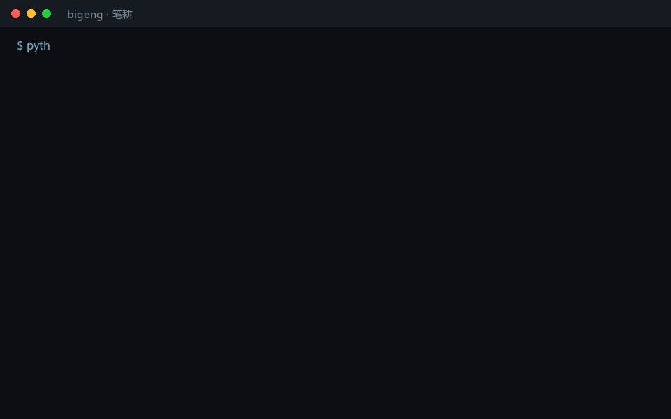
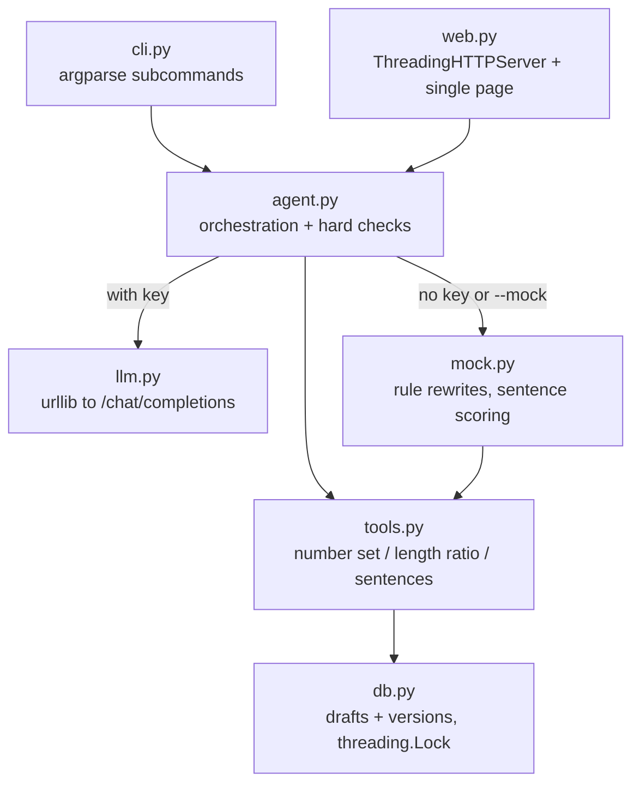

# bigeng (Cultivated Writing)

[](https://github.com/wushiyi105-jpg/bigeng/actions)
[]()
[](./LICENSE)
[](https://codecov.io/gh/wushiyi105-jpg/bigeng)



Drop a draft in: polish, rewrite, expand, shorten, title it — every change kept as a version.

Two things scare me when editing: breaking a number, and losing the version I liked. So bigeng's model only touches wording — **numbers and length ratios are checked locally**. If a rewrite introduces a number the draft never had, the whole result is rejected and the draft stays untouched. Every edit becomes a version, so you can always go back.

## Features

- **Five operations**: `polish`, `rewrite` (formal / colloquial / concise), `expand`, `shrink`, `title`.
- **Hard checks up front**: the number set is compared before and after — any invented number fails the whole rewrite; a length ratio outside that mode's band also fails. A rejected result returns the original text with the reason.
- **Version history**: each rewrite stores mode, body, note and timestamp. `versions` lists them, `version` prints one, `--save` writes back to the draft.
- **Offline mode**: with no key, a rule engine cleans spacing and punctuation, swaps colloquial/formal words, deletes filler, and shortens by scoring sentences on marker words and numbers. Expand is not attempted offline — it returns a skeleton instead, and says so.
- **Two entry points**: CLI for batch edits, web page for live editing. Standard library only.

## Quick start

```bash
git clone https://github.com/wushiyi105-jpg/bigeng.git
cd bigeng
python -m bigeng new draft.txt --title 下午三点总卡住
python -m bigeng polish 1 --save
```

No key means offline mode. To connect a model:

```bash
cp .env.example .env
# fill LLM_API_KEY; defaults to https://api.deepseek.com + deepseek-flash
```

Any OpenAI-compatible endpoint:

```bash
LLM_BASE_URL=https://open.bigmodel.cn/api/paas/v4 LLM_MODEL=glm-4.6 python -m bigeng rewrite 1 --style formal
```

Web:

```bash
python -m bigeng web --port 8766
# http://127.0.0.1:8766
```

Run in Docker (the container uses the default port 8000):

```bash
docker build -t bigeng .
docker run -p 8000:8000 bigeng
```

## Command reference

| Command | What it does |
| --- | --- |
| `new <file> [--title]` | Create a draft; `-` reads stdin; empty title is auto-generated |
| `list` | List drafts |
| `show <draft>` | Chars, sentences, number count, version summary |
| `polish <draft> [--save]` | Polish |
| `rewrite <draft> --style formal\|oral\|brief [--save]` | Rewrite in a style |
| `expand <draft> [--save]` | Expand |
| `shrink <draft> [--ratio 0.5] [--save]` | Shorten, default ratio 0.5 |
| `title <draft>` | Three title candidates |
| `versions <draft>` | Version list |
| `version <draft> <n>` | Print one version |
| `rm <draft>` / `stats` | Delete / stats |
| `web [--host] [--port]` | Web UI |

Global switches `--mock`, `--json`, `--model`, `--base-url`, `--api-key`, `--db` work before or after the subcommand. `<draft>` accepts an id or a title.

## 🤔 Why not just ask a general LLM

A general model can make your draft read better. Bigeng adds the three things it cannot:

1. **Changes have to verify** — if a rewrite introduces a number absent from the draft (say, adding "up 30%"), the whole piece is rejected and redone; expansion and shrinking are held to a length ratio instead of quietly doubling. Chat models love to slip in facts while polishing.
2. **Versions survive** — every change is stored as a version you can roll back and compare. Close a chat window and the previous draft is gone; "that earlier sentence was better" becomes memory only.
3. **Data stays local** — drafts and version history live in local SQLite, and unpublished writing is not uploaded; a model call sends only the current version.
4. **Offline covers half** — with no key the rule layer still cleans spacing, removes repeated words, swaps formal/casual wording and extracts sentences for shrinking; expansion returns a four-slot skeleton and says outright that offline will not invent content.

## 🎯 Use cases

- **Turning meeting notes into a report**: drop the shorthand notes in and run `rewrite --style formal`, then compare versions to see which words changed.
- **Cutting an article to a limit**: a submission caps at 800 words; `shrink` reduces by ratio, and you check no key number was lost.
- **Coming up with titles**: one piece for three channels, `title` returns ten candidates and you refine three.

## 🗺 Roadmap

- **Configurable style word lists**: formal/casual replacements in a config file tuned to your industry.
- **Paragraph-level diff**: mark which paragraph changed and show both versions side by side.
- **Markdown export**: write the current version to a file for another editor.
- **Version tree**: several branches evolving from one draft, not just a linear history.
- **Sensitive phrasing check**: scan for absolutes and unusable wording before submitting.

## ❓ FAQ

**Where do I get an API key?**
The project ships without one. It talks to DeepSeek (`https://api.deepseek.com`) by default — set `LLM_API_KEY`. Any OpenAI-compatible endpoint works.

**Where is data stored, and is it uploaded?**
Drafts and version history are in local SQLite (default `data/bigeng.db`); a model call sends only the version being edited.

**Does it work without a key?**
Cleaning, replacement, shrinking and titles work in rule mode; expansion returns a skeleton and will not invent content. That is the boundary, not a workaround.

**How do I switch models?**
Change `LLM_BASE_URL`, `LLM_MODEL` and `LLM_API_KEY`, or override per run with `--model`.

**Why reject the whole piece when a number changes?**
Because rewriting must not change facts. A new number is either in the original unnoticed or invented by the model; both should send it back, not through.

## How it works



Three decisions:

1. **The model touches wording, not facts.** `tools.new_numbers` diffs the number sets before and after; one extra number voids the whole rewrite. This is the guard against "helpfully" inventing a stat.
2. **Offline does not fake an expansion.** Rules cannot add real content, and padding adjectives is worse than nothing. `mock.expand` emits a four-slot skeleton (claim / example / number / close) labelled as a skeleton.
3. **The original always survives.** Nothing touches the draft body until `--save`; the initial text is stored as an `original` version, so there is always a way back.

Storage is one SQLite file with `check_same_thread=False` plus a `threading.Lock`; default `data/bigeng.db`, overridable with `BIGENG_DB`.

## Layout

```
bigeng/
├── bigeng/
│   ├── __init__.py / __main__.py
│   ├── llm.py     # OpenAI-compatible client + .env loader
│   ├── db.py      # drafts + versions (thread-safe)
│   ├── tools.py   # number sets, length ratio, sentences, titles
│   ├── mock.py    # offline rule rewrites
│   ├── agent.py   # five operations + hard checks
│   ├── cli.py     # command line
│   └── web.py     # web UI
├── data/draft-sample.json
├── tests/test_bigeng.py
├── assets/demo.gif
├── .github/workflows/test.yml
├── pyproject.toml
├── README.md / README.en.md
└── CHANGELOG.md / SECURITY.md / CODE_OF_CONDUCT.md / CONTRIBUTING.md
```

## Author

Luo Zhizhi · 15071889700

MIT License, Copyright (c) 2026 wushiyi105-jpg
