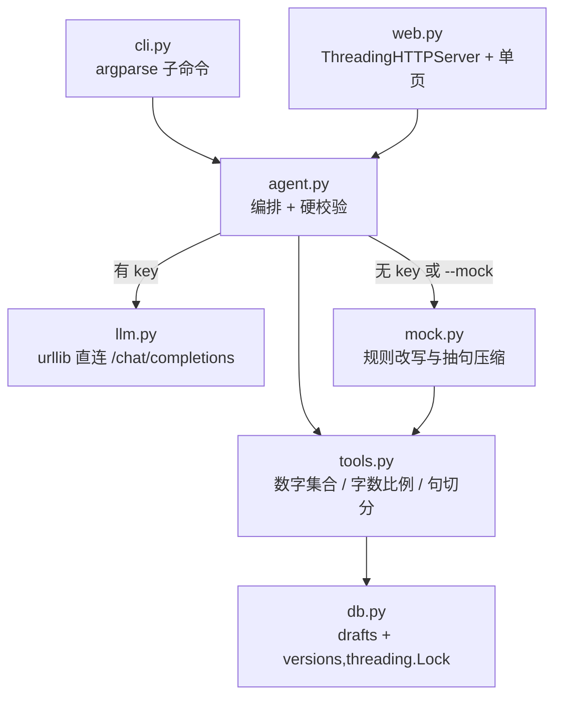

# 笔耕 bigeng

[](https://github.com/wushiyi105-jpg/bigeng/actions)
[]()
[](./LICENSE)
[](https://codecov.io/gh/wushiyi105-jpg/bigeng)


把草稿丢进去,润色、改写、扩写、缩写、起标题,每次改动都留版本。

我改稿最怕两件事:一是把数字改错,二是改完找不到上一版。所以笔耕的模型只负责措辞,**数字和字数比例留在本地算**——改写后多出一个原文没有的数字,整篇不采用,原稿一个字都不动。每改动一次存一个版本,想回退随时能翻出来。

## 功能特性

- **五种改法**:`polish` 润色、`rewrite` 按风格改写(正式 / 口语 / 简洁)、`expand` 扩写、`shrink` 缩写、`title` 起标题。
- **硬校验拦在前面**:改完比对数字集合,凭空多出来的数字直接判不通过;字数变化率超出该模式区间也判不通过。不通过的稿子会原样退回,并说明原因。
- **版本历史**:每次改写存一个版本(含模式、正文、备注、时间),`versions` 看列表,`version` 看全文,`--save` 才写回正文。
- **离线模式**:没有 key 时走规则引擎——清空格标点、口语书面互转、删填充词、按标记词与数字打分抽句压缩。扩写离线不做,只给一份骨架,理由见下。
- **双入口**:命令行适合批量改稿,网页适合边看边改。纯标准库,`python -m` 直接跑。

## 快速开始

```bash
git clone https://github.com/wushiyi105-jpg/bigeng.git
cd bigeng
python -m bigeng new draft.txt --title 下午三点总卡住
python -m bigeng polish 1 --save
```

不配 key 自动进离线模式;想接模型:

```bash
cp .env.example .env
# 填 LLM_API_KEY,默认 https://api.deepseek.com + deepseek-flash
```

任何 OpenAI 兼容端点都行:

```bash
LLM_BASE_URL=https://open.bigmodel.cn/api/paas/v4 LLM_MODEL=glm-4.6 python -m bigeng rewrite 1 --style formal
```

网页:

```bash
python -m bigeng web --port 8766
# http://127.0.0.1:8766
```

Docker 运行(容器内用默认端口 8000):

```bash
docker build -t bigeng .
docker run -p 8000:8000 bigeng
```

## 命令参考

| 命令 | 作用 |
| --- | --- |
| `new <file> [--title]` | 建稿,`-` 从 stdin 读,标题留空则自动起 |
| `list` | 列出稿子 |
| `show <稿>` | 字数、句数、数字处数、版本概况 |
| `polish <稿> [--save]` | 润色 |
| `rewrite <稿> --style formal\|oral\|brief [--save]` | 按风格改写 |
| `expand <稿> [--save]` | 扩写 |
| `shrink <稿> [--ratio 0.5] [--save]` | 缩写,比例默认 0.5 |
| `title <稿>` | 三个标题候选 |
| `versions <稿>` | 版本列表 |
| `version <稿> <版本号>` | 看某一版全文 |
| `rm <稿>` / `stats` | 删稿 / 统计 |
| `web [--host] [--port]` | Web UI |

全局开关 `--mock`、`--json`、`--model`、`--base-url`、`--api-key`、`--db`,放在子命令前后都认。`<稿>` 可写 id 或标题。

## 🤔 为什么不用通用大模型直接问

通用模型能把你的稿子改得更好看,但笔耕补的是它做不到的三件事:

1. **改动要能核** —— 改写后如果多出原稿里没有的数字(比如替你补了「增长 30%」),整篇作废重来;扩写、缩写的字数比例也被卡在区间里,不许悄悄翻倍。通用模型最常见的毛病就是改写时顺手加事实。
2. **版本留得住** —— 每次改动存一版,可以回退、可以对比;通用对话关掉窗口就没了,「上一版那句更好」只能凭记忆。
3. **数据留在本地** —— 草稿、版本历史都在本地 SQLite,未发表的稿子不上传;调模型时只发当前这一版。
4. **离线能做一半** —— 没 key 时规则层照做:清空格、去重复词、正式/口语替换、缩写抽句;扩写只给四槽骨架并明说「离线不编内容」,不假装能写。

## 🎯 适用场景

- **把口语稿改成汇报稿**:会议随手记的口语稿丢进去,`rewrite --style formal`,改完对照版本看哪些词被换了。
- **长文压到字数上限**:投稿要求 800 字,`shrink` 按比例压,压完核对有没有丢关键数字。
- **起标题**:一篇稿子要发三个渠道,`title` 给十个候选,挑三个改一改就用。

## 🗺 Roadmap

- **风格词表可配置**:正式/口语的替换词表放到配置文件,按行业习惯改。
- **段落级对比**:版本之间标出哪一段改了、改前改后并排看。
- **导出 Markdown**:把当前版本导成文件,方便贴进别的编辑器。
- **版本树**:不只是线性历史,同一稿的几个分支各自演化。
- **敏感表述检查**:投稿前扫一遍绝对化用语与不能写的表述。

## ❓ FAQ

**API key 从哪来?**
项目不带 key。默认接 DeepSeek(`https://api.deepseek.com`),注册后填 `LLM_API_KEY`;OpenAI 兼容端点都能换。

**数据存在哪,会上传吗?**
草稿与版本历史在本地 SQLite(默认 `data/bigeng.db`);调模型时只发当前要改的这一版正文。

**没有 key 能不能用?**
能做清理、替换、缩写、起标题的规则版;扩写只给骨架,不会替你编内容。这是边界,不硬撑。

**怎么换模型?**
改 `LLM_BASE_URL`、`LLM_MODEL`、`LLM_API_KEY`,或用 `--model` 临时覆盖。

**为什么改写后数字变了就整篇作废?**
因为改写不应该改变事实。多出来的数字要么是原文有而你没注意,要么是模型编的;两种都该退回重来,而不是直接采用。

## 工作原理



三处取舍:

1. **模型只碰措辞,不碰事实**。`tools.new_numbers` 比对改写前后的数字集合,多一个就整篇作废。这一条挡掉了我最怕的"顺手编个数据"。
2. **离线不硬造扩写**。规则引擎无法真的加内容,硬扩只会灌形容词。所以 `mock.expand` 输出的是「论点 / 例子 / 数据 / 收束」四槽骨架,标清楚是骨架,不假装成文。
3. **原文永远在**。`--save` 之前的任何改写都只落版本、不动正文,初稿以 `original` 模式存第一条版本,回退有路。

SQLite 单文件,`check_same_thread=False` + `threading.Lock`,默认 `data/bigeng.db`,`BIGENG_DB` 可改。

## 目录结构

```
bigeng/
├── bigeng/
│   ├── __init__.py / __main__.py
│   ├── llm.py     # OpenAI 兼容客户端 + .env 加载
│   ├── db.py      # drafts + versions(线程安全)
│   ├── tools.py   # 数字集合、字数比例、句切分、标题候选
│   ├── mock.py    # 离线规则改写
│   ├── agent.py   # 五种改法 + 硬校验
│   ├── cli.py     # 命令行
│   └── web.py     # Web UI
├── data/draft-sample.json
├── tests/test_bigeng.py
├── assets/demo.gif
├── .github/workflows/test.yml
├── pyproject.toml
├── README.md / README.en.md
└── CHANGELOG.md / SECURITY.md / CODE_OF_CONDUCT.md / CONTRIBUTING.md
```

## 作者

shiyi · GitHub [@wushiyi105-jpg](https://github.com/wushiyi105-jpg) · wushiyi105@gmail.com

MIT License,Copyright (c) 2026 wushiyi105-jpg
